# Kbroo Studio

A visual, drag-and-drop page builder plugin for WordPress.

## Status

In progress towards v1. Done so far: full-screen editor, sections and columns, inner sections and flexbox containers (nested any depth), widgets (Heading, Text, Image, Button, Spacer, Divider, HTML, Shortcode, Menu anchor, Icon, Social icons, Testimonial carousel, Posts, Form, Icon list, Icon box, Image box, Video, Image gallery, Image carousel), backgrounds (colour, image per device, gradient, video, hover) and background overlays, entrance animations and hover effects, shape dividers, custom CSS per element and site-wide, a Kbroo Studio admin menu, a template library, a header and footer builder (with Nav menu, Site logo and Site title widgets), a blog archive template (with Archive title, WordPress widgets and a Sidebar widget), show and hide by date, day, time or login, updates from GitHub releases, copy and paste between pages, JSON layout storage, front-end rendering, undo/redo, Content/Style/Advanced settings tabs, desktop/tablet/mobile settings, the Navigator, revision history, page settings (hide title, full width and canvas layouts, comments, status, excerpt, featured image), and global colours and fonts.

## Moving from Elementor

**Kbroo Studio > Move from Elementor** in the WordPress admin menu:

1. **Import colours and fonts** copies Elementor's Site Settings (global colours and fonts) into Kbroo Studio's, keeping their ids so converted pages stay linked to them. Fonts the pages use are added from Google Fonts.
2. **Convert** each page (or use the *Convert to Kbroo Studio* row and bulk actions in the Pages list). Sections, inner sections, columns, containers and the widgets Kbroo Studio has keep their settings; widgets it does not have yet become fallback blocks that still show (live while Elementor is active, otherwise as they looked when converted). The report lists those blocks and any settings not carried over yet. The page's *Hide title* and page layout carry over too (Elementor Canvas becomes Canvas, Elementor Full Width becomes Full width); Elementor's own page template is left as it was.
3. **Saved templates**: Elementor's saved page, section and container templates, and Elementor Pro headers, footers and archive templates, convert into Kbroo Studio's template library (one at a time or all at once). Converting again replaces the copy; Elementor's templates are left as they are. Headers, footers and archives keep their display conditions but arrive switched off, so the site does not change until you check them and switch them on (and turn Elementor's off).
4. **Switch back to Elementor** at any time. Elementor's data is never changed or deleted; switching back only turns the Kbroo Studio version off, and *Switch to Kbroo Studio* turns it on again.

Opening an unconverted Elementor page in the Kbroo Studio editor converts it on the spot; nothing changes until you save. Exported Elementor template files (.json) import into the template library.

## Install

Download `kbroo-studio.zip` from the [latest release](https://github.com/robbodley/kbroo-studio/releases/latest) and upload it in **Plugins > Add New Plugin > Upload Plugin**, then activate **Kbroo Studio**. (Or copy this folder to `wp-content/plugins/kbroo-studio`.) There is no build step: the editor is plain JavaScript and CSS.

### Updates

Kbroo Studio updates itself from this repository's GitHub releases, like any plugin from WordPress.org: when a newer release is out, it shows on **Dashboard > Updates** and the Plugins screen (with its release notes under *View details*), and **Enable auto-updates** on the Plugins screen installs new versions in the background. The Kbroo Studio overview page shows the installed plugin and theme versions, and its *Check for updates* button asks GitHub straight away and offers *Update Kbroo Studio* and *Update Kbroo Hello* buttons when newer versions are out (WordPress itself is not checked or updated from there). Otherwise GitHub is asked at most every few hours.

Sites running 0.1.0 have no updater yet, so update those once by hand (upload the 0.2.0 zip; WordPress offers to replace the installed version). From 0.2.0 on, updates arrive by themselves.

The **Kbroo Hello** theme updates the same way, from the same releases (see [theme/README.md](theme/README.md)). The plugin and theme each name the oldest version of the other they work with; if one is too old, admins see a notice asking them to update it.

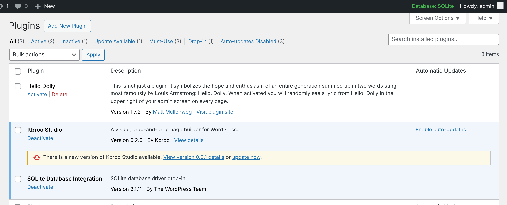

### Making a release

Releases happen by themselves when `main` gets a new version:

1. Changes are merged to `main` as usual, without changing the version. Nothing is released.
2. When a batch is ready, a small pull request raises the version: in `kbroo-studio.php`, both the `Version:` header and `KBROO_STUDIO_VERSION`. If the theme changed, also its version in `theme/kbroo-hello/style.css`, `KBROO_HELLO_VERSION` in its `functions.php` and `Stable tag` in its `readme.txt` (all three the same; the theme's version doesn't have to match the plugin's, but a theme change always goes out with a new plugin version). If one now needs the other's newer version, raise `KBROO_STUDIO_MIN_HELLO` or `KBROO_HELLO_MIN_STUDIO`.
3. Merging it runs the *Release* workflow: it checks the versions, builds `kbroo-studio.zip` (the plugin, without the docs and starter theme) and `kbroo-hello-<version>.zip` (the theme) with `bin/build-zip.sh`, and publishes release `v<version>` with both attached and notes listing the merged pull requests. Sites then offer the updates; a theme update is offered only when the theme's version went up.

If the versions don't match, the workflow fails and nothing is released. A failed release can be retried from the Actions tab (*Release > Run workflow*). Publishing a release by hand on GitHub still works too: its zips are attached when it is published.

Requires WordPress 6.2+ and PHP 7.4+.

## Using it

Kbroo Studio has its own menu in the WordPress admin sidebar. Its **Overview** page lists the pages built with Kbroo Studio, has a **New page** button that opens a blank page in the editor, and links to the site colours, fonts and CSS, **Templates**, **Move from Elementor** and **Form messages**.

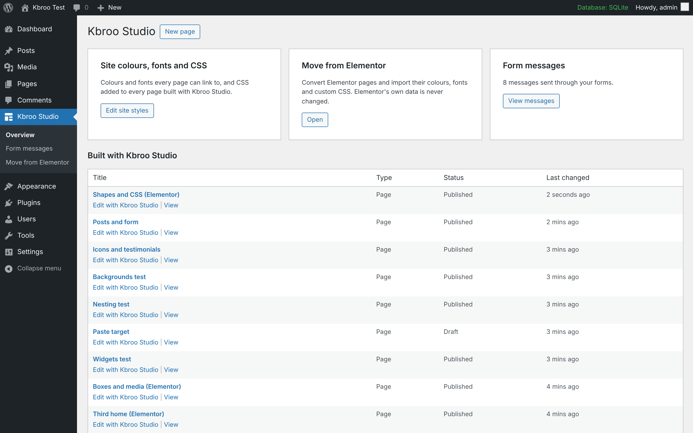

Open a page or post with any of these:

- **Edit with Kbroo Studio** in the block editor sidebar (Summary panel) or under the title in the classic editor
- the **Edit with Kbroo Studio** row link in the Pages / Posts lists
- the **Edit with Kbroo Studio** admin bar link on the front end

In the editor:

- Drag a widget from the left panel into a column, or between sections to start a new one. Clicking a widget adds it after the selected element.
- **Add section** offers column structures (100, 50/50, 33/33/33, 66/33, 33/66, 25x4).
- Click any section, column or widget to edit its settings in the Content, Style and Advanced tabs. Hover toolbars duplicate, delete, add columns, and drag sections (move handle).
- The device buttons in the top bar preview tablet and mobile widths. Settings marked with a device icon are saved per device: a blank tablet or mobile value inherits from the larger screen.
- **Backgrounds**: sections, columns and containers have Background, Background on hover and Background overlay settings in the Style tab (widgets have them in Advanced). A background is a colour or image (image, position, size and repeat can differ per device), a two-colour gradient, or, for sections and containers, a YouTube, Vimeo or MP4 video. The overlay sits between the background and the content, with its own opacity and blend mode, and can change on hover.
- Advanced has margin, padding, CSS ID and classes, **Motion effects** (an entrance animation such as fade in up, played once when the element scrolls into view, with a duration and delay), and hide on desktop / tablet / mobile. Hidden elements show faded in the editor. Animations are skipped for visitors who ask their system for reduced motion.
- **Show and hide** (Advanced tab, any section, column, container or widget): show it *only when*, or *except when*, the rules you fill in are all true: from and until a date and time, on chosen days of the week, between two times each day (a window can run past midnight), and for logged-in or logged-out visitors. Times are in the site's time zone. A hidden element is left out of the page entirely. In the editor it stays visible, faded, and every element with rules has a clock badge. Pages with rules ask page caches (WP Super Cache, W3 Total Cache, WP Rocket...) not to keep a copy, so they change on time. Premium Addons' Display Conditions convert where they match (date range, date, days, time range, login status); others are listed in the report and the element stays always shown.

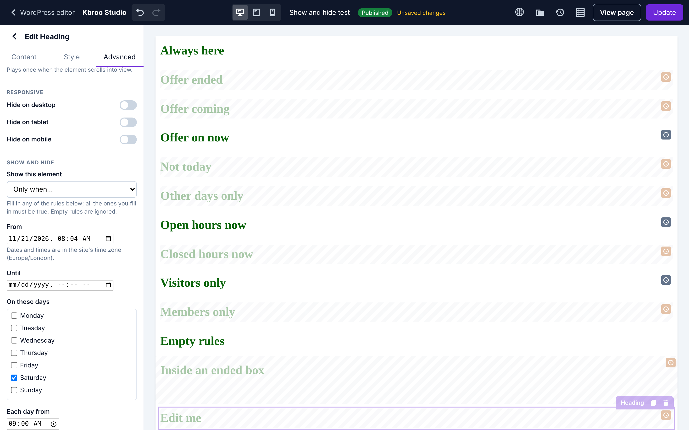
- **Icons** come from Font Awesome Free (solid, regular and brands), bundled with the plugin as SVG: pages load only the icons they use, with no icon font or outside request. The icon picker searches by name and keyword.
- Lists such as slides and social icons are edited item by item in the panel: add, open, reorder, duplicate or remove each one.
- **Posts** shows a grid of posts (classic or cards), picked by post type, categories or tags to include or leave out, order and offset, with numbered and/or previous/next pages. The editor previews the real posts.
- **Form** builds a contact form from fields (text, email, textarea, phone, number, URL, date, time, select, radio, checkboxes, acceptance, hidden). Each message is emailed (to the site admin address unless the form names another, with Reply-To set to the sender) and saved under Kbroo Studio > **Form messages**. Spam protection is built in with no outside service: a hidden trap field, a minimum time before sending, and a limit of 5 messages per visitor in 10 minutes. Forms send without reloading the page and still work with JavaScript off. Developers can hook `kbroo_studio_form_submitted`.

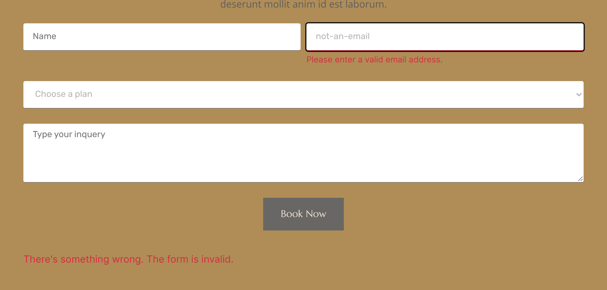
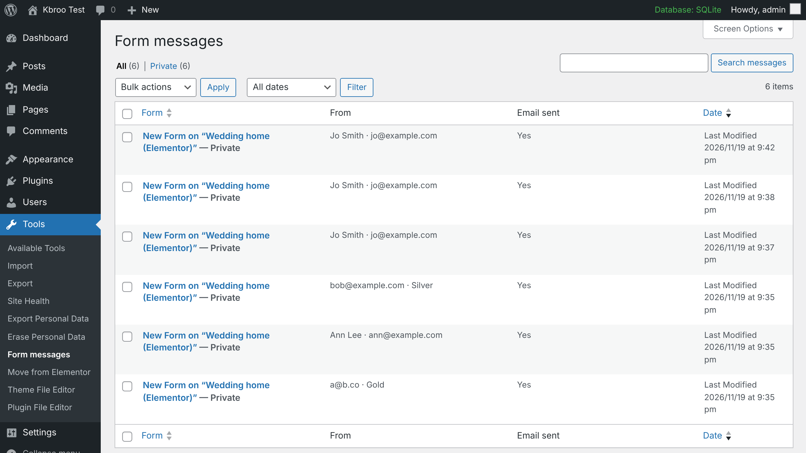

- **Icon box** and **Image box** put an icon or image above, left or right of a title and description, with an optional link. **Icon list** shows items with icons, stacked or in a row, with optional dividers and links.
- **Video** plays YouTube, Vimeo or a file from the Media Library, with start and end times, autoplay, mute, loop and aspect ratio. With an **image overlay**, nothing loads from YouTube or Vimeo until the visitor presses play; YouTube uses its privacy-enhanced (no-cookie) address by default.
- **Image gallery** (a grid) and **Image carousel** take several Media Library images at once. Images can open in a built-in **lightbox** with captions, previous/next and keyboard support.

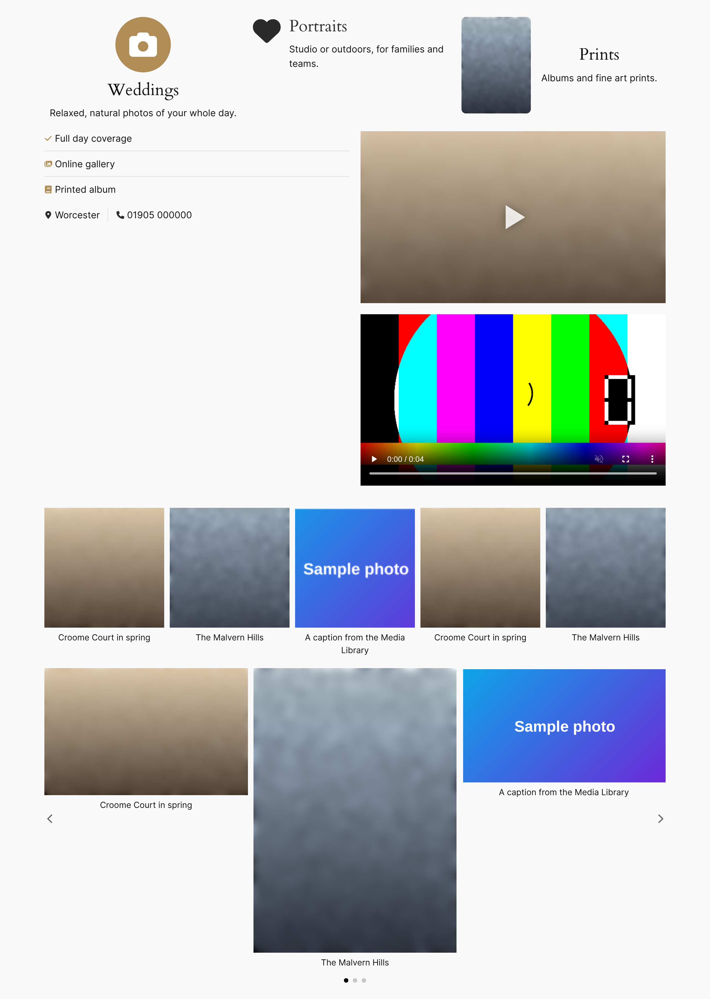

- **Shape dividers**: sections and containers can have a shape (waves, mountains, tilt, zigzag, curve, clouds, arrow and more, 18 in all) on their top and bottom edges, with colour, width, height, flip, invert, and an option to sit in front of the content.
- **Custom CSS** (Advanced tab): CSS for one element, where `selector` stands for that element, e.g. `selector .kbroo-heading { text-transform: uppercase; }`. It shows live in the editor.

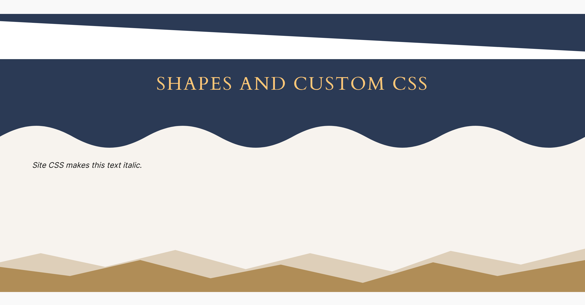

- **Templates** (folder icon in the top bar, or the Templates button under the page): save the whole page, or right-click a section or container and choose *Save as template*. Templates are sections or pages; search and filter them and insert one with a click (it goes at the end of the page and can be undone). An inserted template is a copy, so changing the template later leaves pages alone. Templates are listed under Kbroo Studio > **Templates**, where *New template* starts one from scratch in the editor; they never show on the site by themselves.
- Click the page title in the top bar to rename the page or template.
- **Header and footer**: under Kbroo Studio > Templates, *New header* or *New footer* opens one in the editor. Build it like any page; the **Nav menu** (a WordPress menu from Appearance > Menus, across or down, with drop-down submenus and a menu button on tablets or phones), **Site logo** and **Site title** widgets are made for it. The eye icon in the top bar sets **where it shows**: the entire site, the front page, all pages, all posts, the blog and archives, the 404 page, or chosen pages and posts, with exceptions. It can be switched off, and a header can stick to the top while scrolling. Where several fit a page, the most specific wins. It replaces the theme's own header or footer in classic themes (via `get_header` / `get_footer`) and in block themes (the header and footer template parts).

- **Blog archive**: *New blog archive* under Kbroo Studio > Templates designs the blog page, category and tag pages and search results. Put a **Posts** widget in it with the source *Current archive*: it shows that archive's posts with WordPress's paging (Settings > Reading sets how many per page). **Archive title** shows "Category: News", "Search results for ..." and so on. Where it shows: all archives, the blog page, categories, tags or search results, with exceptions; the most specific wins, so a category template can sit beside a general one. The theme's header and footer (or Kbroo Studio's) stay around it, in classic and block themes.
- **WordPress widgets**: **Categories** (list or drop-down, with post counts), **Recent posts** (with dates) and **Search** work in any page or template, and **Sidebar** shows a whole widget area from Appearance > Widgets. Elementor's WordPress widgets convert with their settings.

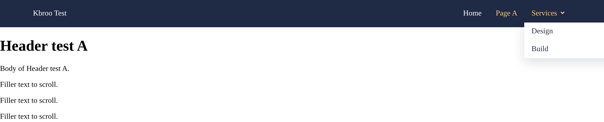
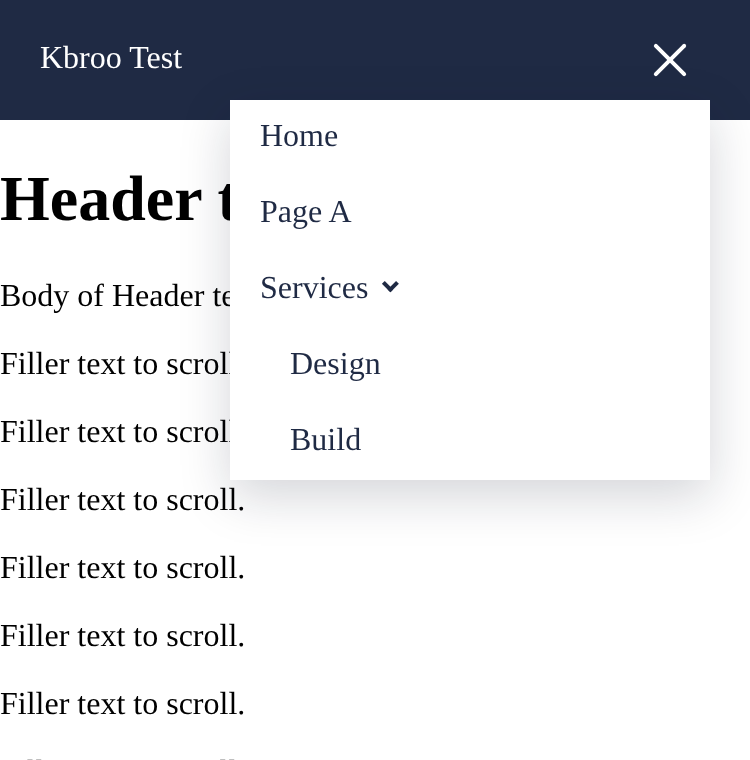
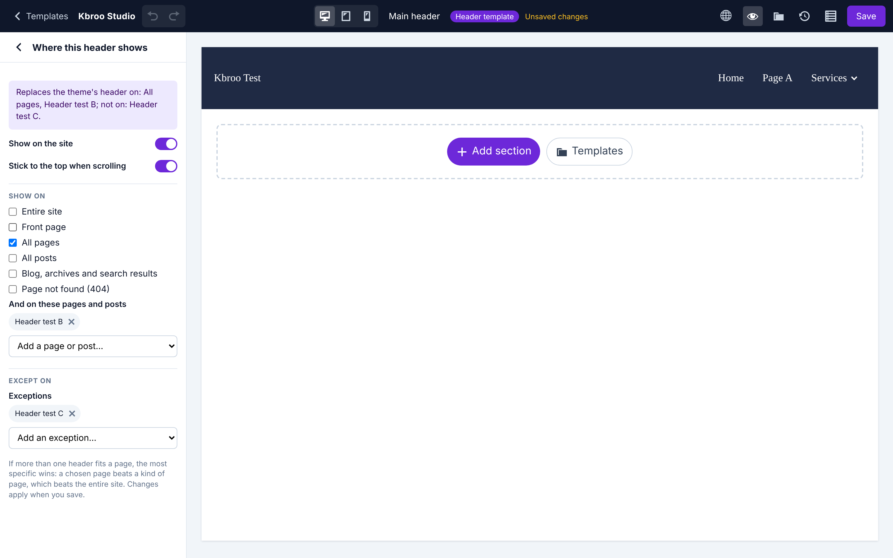

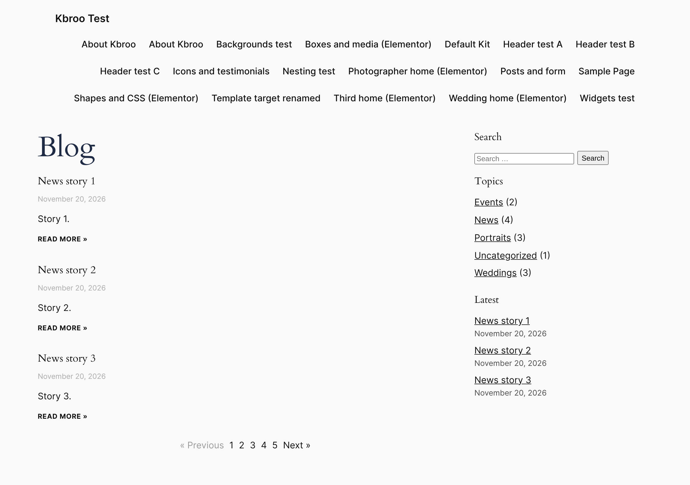
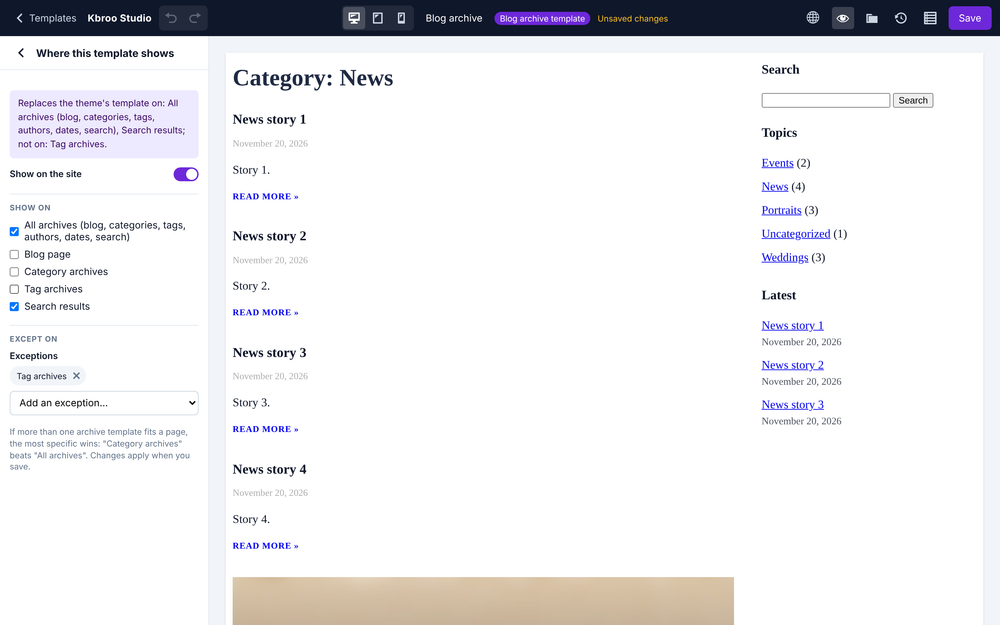

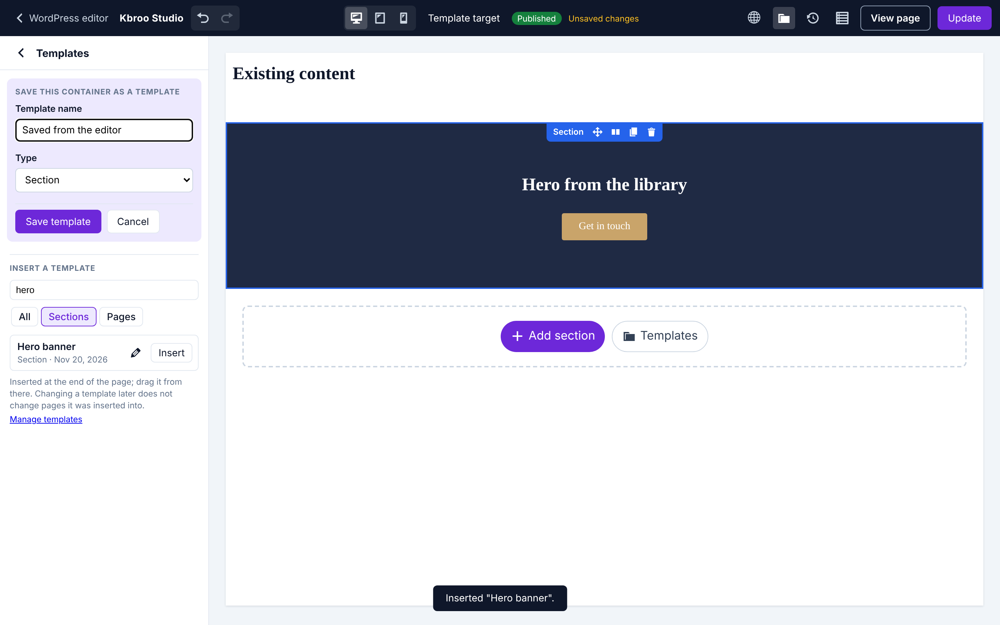
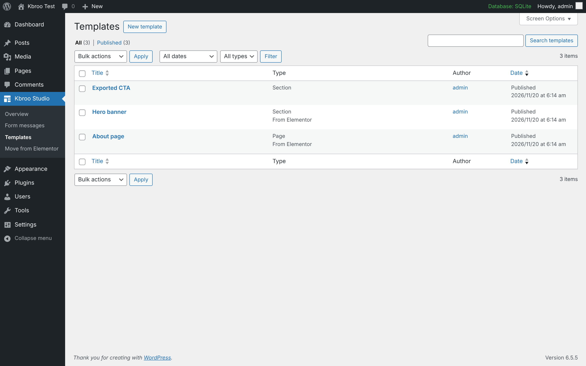

- Buttons and images have a **hover animation** (grow, float, sink, rotate...), and images have CSS filters (brightness, contrast, saturation, blur, hue), normal and on hover.
- **Copy and paste**: right-click any element for Duplicate, Copy, Paste, Paste style and Delete, or use Ctrl+C / Ctrl+V (Ctrl+Shift+V pastes style only). Copied elements go on the system clipboard, so they paste into another page or another site running Kbroo Studio.
- **Page settings** (gear in the top bar, pages and posts): the title, status (draft, pending review, private, published), excerpt, featured image and *Allow comments*, plus:
  - **Hide title** leaves out the theme's title above your layout. Kbroo Hello hides it on builder pages unless you turn this off; other themes show it unless you turn it on (it is then hidden with CSS on `h1.entry-title`, changeable with the `kbroo_studio_hide_title_selector` filter).
  - **Page layout**: *Default* (the theme's own template), *Full width* (the site header and footer, Kbroo Studio's or the theme's, and the content edge to edge with no theme title) or *Canvas* (a blank page: no header, footer or title). Both work with any theme, classic or block.
  - When comments are allowed, they show under the content at a readable width (with Kbroo Hello, and in the Full width and Canvas layouts).
- **Navigator** (list icon in the top bar): the page as a tree. Click to select, drag to reorder (widgets between columns, columns between sections), double-click to rename.
- **Revisions** (clock icon): every save is a WordPress revision with the layout attached. Click one to preview it read-only, then restore it (undoable) and save.
- **Site colours, fonts and CSS** (globe icon): site-wide colours and font presets, and CSS added to every page built with Kbroo Studio (Elementor's site-wide custom CSS is imported here). Link any colour setting to a global with its globe button, and any typography section to a global font. Changing a global restyles every page that links to it. Editing them needs the `edit_theme_options` capability. Google Fonts are loaded only for fonts a page uses.
- `Ctrl/Cmd+Z` undoes, `Ctrl/Cmd+Shift+Z` or `Ctrl/Cmd+Y` redoes, `Ctrl/Cmd+S` saves, `Delete` removes the selected element, `Esc` deselects.

## How it works

| Piece | Where |
| --- | --- |
| Bootstrap, autoloader | `kbroo-studio.php`, `src/Plugin.php` |
| Editor route `post.php?post=ID&action=kbroo_edit` and launchers | `src/Editor.php`, `templates/editor.php`, `assets/js/launcher.js` |
| Editor app (canvas, drag and drop, settings panel, saving) | `assets/js/editor.js`, `assets/css/editor.css` |
| Layout schema, control schema and sanitizing | `src/Layout.php`, `src/Controls.php`, `src/ControlGroups.php` |
| CSS generated from settings (PHP and JS twins) | `src/Css.php`, `assets/js/css.js` |
| Save endpoint `POST /wp-json/kbroo/v1/documents/<id>` | `src/Rest.php` |
| Widgets (PHP render + JS preview) | `src/Widgets/*`, `assets/js/widgets.js` |
| Global colours and fonts, font list | `src/Globals.php`, `src/Fonts.php` |
| Revisions | `src/Revisions.php` |
| Template library (`kbroo_template` posts, `GET/POST /wp-json/kbroo/v1/templates`) | `src/Templates.php` |
| Admin menu and Overview | `src/Admin.php` |
| Shape dividers | `src/ShapeDividers.php` |
| Site header, footer and blog archive (display rules, replacing the theme's) | `src/ThemeBuilder.php`, `templates/site-header.php`, `templates/site-footer.php`, `templates/site-archive.php` |
| Show and hide rules | `src/Visibility.php` |
| Updates from GitHub releases, release zips | `src/Updater.php`, `theme/kbroo-hello/inc/updater.php`, `bin/build-zip.sh`, `.github/workflows/release.yml` |
| Front-end rendering | `src/Renderer.php`, `src/Frontend.php`, `assets/css/frontend.css` |

The layout is stored as JSON in the `_kbroo_data` post meta, and `_kbroo_edit_mode = builder` marks a page as built with Kbroo Studio. The tree follows Elementor's: the page holds sections and containers, sections hold columns, columns hold widgets, inner sections and containers, and containers hold widgets and containers (see `Layout::allowed_children()`):

```json
{
  "version": 1,
  "elements": [
    { "id": "a1b2c3d", "elType": "section", "settings": { "background_color": "#f5f3ff" },
      "elements": [
        { "id": "e4f5a6b", "elType": "column", "settings": { "_inline_size": 100 },
          "elements": [
            { "id": "c7d8e9f", "elType": "widget", "widgetType": "heading",
              "settings": { "title": "Hello", "header_size": "h1",
                            "typography_font_size": { "unit": "px", "size": 56 },
                            "typography_font_size_mobile": { "unit": "px", "size": 32 } } }
          ] } ] } ]
}
```

Setting names and value shapes follow Elementor's (`title`, `header_size`, `_inline_size`, `typography_font_size`, `_padding`, `hide_mobile`, ...), so Elementor data converts with little mapping. Responsive settings store tablet and mobile values as `<key>_tablet` and `<key>_mobile`.

Styling is never inlined: each control declares CSS `selectors`, and the renderer turns the settings into one `<style>` block per page, with tablet (max 1024px) and mobile (max 767px) values in media queries. Only validated values reach the CSS (hex colors, numbers, units and options from fixed lists).

Every save is sanitized server side against each element's control definitions (unknown widgets and settings are dropped, HTML goes through `wp_kses_post`). A rendered HTML copy is also written to `post_content`, so the content survives if the plugin is deactivated. On the front end, `the_content` is replaced with the rendered layout for builder pages.

### Adding a widget

1. Subclass `KbrooStudio\Widgets\Widget` (name, title, icon, `widget_controls()`, `render()`), and register it on the `kbroo_studio_register_widgets` action. The Advanced tab is added automatically; `ControlGroups` has typography, border, background and alignment sets.
2. Register a matching preview with `KbrooStudio.registerWidget( name, settings => html )` in a script that loads after `kbroo-widgets` in the editor. Or return true from `server_preview()` and the editor shows HTML rendered by your PHP `render()` instead (used by the Shortcode widget). Server previews also bring the stylesheets plugins enqueue for that output on the front end (on `wp_enqueue_scripts` or from inside a shortcode), so a gallery or form from another plugin looks the same in the editor as on the page. The theme's own styles are left out so they can't restyle the editor; the `kbroo_studio_preview_style_handles` filter changes which stylesheets are added.

Global colours and fonts are stored in the `kbroo_global_styles` option in the shape of Elementor's kit (`colors` / `typography` lists with `_id` and `title`). Elements link to them through Elementor's `__globals__` setting, e.g. `"__globals__": { "title_color": "globals/colors?id=primary" }`, and the CSS uses `var(--kbroo-global-color-primary)`.

Hooks: `kbroo_studio_fonts` (filter), `kbroo_studio_post_types` (filter), `kbroo_studio_register_widgets` (action), `kbroo_studio_render` (filter).

## Credits

Icons: [Font Awesome Free](https://fontawesome.com) 6.7.2, CC BY 4.0 (see `data/icons/FONT-AWESOME-LICENSE.txt`).
